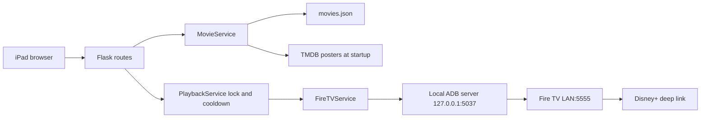
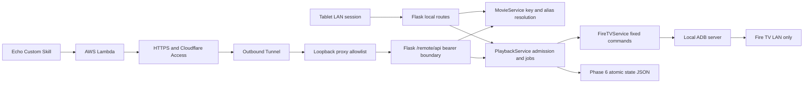

# Current and target architecture

Inspected 2026-11-07. The Phase 1 section below records the original baseline.
Phase 2 is now locally implemented under separate user approval; see the
[implementation/release runbook](phase-2-runbook.md) for current behavior and
verification. The separately requested Phase 3 tablet client is locally
implemented behind the same default-off flag; see [tablet verification](tablet-verification.md).
Production and actual-iPad release gates remain pending. Phase 4–6 remain proposed.

## Current system (Phase 1)

`app.py` exposes `create_app(config=Config)` and eagerly creates `app` on import.
It loads the catalog and refreshes missing posters during creation. A missing
TMDB key aborts startup even with cached posters. Services live in
`app.extensions`; fixtures reload app/config and replace actual launches.

| Component | Verified responsibilities and limitations |
|---|---|
| `config.py` | Repository .env; class-level settings; default development secret; 5-second ADB inactivity timeout; 2-second cooldown |
| MovieService | JSON array; poster caching; shallow list copy; Disney ID lookup; malformed/missing catalog becomes empty; no per-entry validation |
| PlaybackService | Nonblocking process-local lock; monotonic cooldown; failed attempts consume cooldown; legacy success text |
| FireTVService | Finds/starts ADB; finite socket timeouts; persistent device; one reconnect for some failures; no shell retry on timeout/unauthorized |
| `/` | Jinja grid; 85px minimum columns; clickable divs; transient toast; provider IDs; 300-second public cache |
| `/play/<video_id>` | Mutating GET; valid unknown IDs pass through; 200 success, 400 invalid, 429 busy, 403 device authorization, 500 ADB failure |
| `/health` | 200 status ok once serving; no-store; no device, catalog or playback verification |
| systemd | Gunicorn 0.0.0.0:8000; one worker/four threads; HOME preserves authorized ADB identity |

Launch wakes the TV (224), sends Home (3), then launches a Disney+ VIEW URL with
`startTime=0`. Preserve this sequence. Completion only establishes command-delivery
evidence. Shell output is currently ignored, so Android activity errors can be
misreported as success. Socket limits are per-operation inactivity limits, not
total request deadlines. A broken-connection retry can duplicate partial delivery.

The catalog has 44 entries, all with IDs, two without posters at inspection.
Preserve every entry, including series-like titles. `watchlist_scraper.js`
produces title/ID records; `process_watchlist.py` prints mappings for an obsolete
`DISNEY_IDS` constant rather than updating JSON. Do not follow that old import path.

Tests cover catalog shape/lookup, legacy response/pass-through, health isolation,
cooldown/busy, lock release, exact launch command, one reconnect, authorization,
startup timeout and socket closure. A loopback test exercises actual ADB library
timeouts. They do not prove on-screen playback or UI accessibility. Bundled Python
lacks pytest; tests were inspected but not successfully executed here.

## Differences from the proposed architecture

There is no stable-key API, alias resolver, job status, authentication, tunnel,
Alexa code, transport control, favorites store or readiness check. Existing health
must stay non-waking. README describes a deployment workflow absent from this
checkout; `deploy.sh` does hard-reset and restart. Documentation cannot establish
the actual production deployment triggers.

No existing AGENTS, PLANS or docs planning files were found. README remains the
original setup reference; these documents qualify it without replacing it. Real
.env values and ADB credentials were not inspected.

## Target system

The public URL is `/api/...`; a loopback proxy maps it to distinct
`/remote/api/...` Flask routes, which always require bearer credentials even on
LAN. Local and remote contracts/services are identical. Authentication does not
depend on a spoofable forwarding header. Only explicit paths/methods are proxied.

The LAN UI remains usable during AWS/Cloudflare/internet outages, with cached or
fallback posters. Phase 4 grants signed sessions only to explicitly trusted LAN
clients; machine tokens never enter browser JavaScript. Remote tablets are out of scope.

## Service and state boundaries

- MovieService owns immutable keys, private provider mapping, public projections,
  validation and deterministic title/alias resolution. Unknown/ambiguous requests
  have no side effects. Lambda never selects a provider ID.
- PlaybackService owns one active/reserved command slot, legacy/new coordination,
  cooldown, request IDs, jobs and idempotency. One background dispatcher executes
  admitted new requests. No unbounded queue, thread-per-request or external broker.
- FireTVService owns connections, fixed ADB templates, timeout/retry classification.
  Routes, Lambda, tablets and Home Assistant never issue ADB commands.
- Phase 6 StateService owns small household JSON preference/history files, atomic
  writes and recovery. Catalog authoring stays separate.
- Connectivity, last request, delivery and playback are distinct. Without an
  independently verified observer, `playback.state` is always `unknown`.
  Delivering pause/resume does not establish paused/playing.

## Data and compatibility

Keep the catalog array and `title`, `id`, `poster`; add `key`, `aliases`.
Legacy rendering retains its projection. Migration is an explicit backed-up CLI,
not a startup rewrite. Public APIs exclude provider IDs, device addresses and raw
shell diagnostics. Renaming titles never renames keys.

Jobs/idempotency live in bounded RAM with a random boot ID. Restart loses pending
jobs and evidence and never replays them. Phase 6 uses versioned JSON personal
state. Recents mean delivered launch requests, not verified watching or completion.

## Deployment constraints and linked designs

One Gunicorn worker is required. Start the dispatcher lazily in the worker, never
during module import or preloading. A restart may interrupt delivery and must
leave playback unknown. Preserve service HOME and authorized ADB keys.

Cloudflare is preferred for outbound-only access, with separate backend
authentication. Never forward ADB or expose 8000 to WAN. Bind/firewall/proxy changes
require approval and a working LAN rollback path. See [Phase 4](specs/04-secure-connectivity.md).

Contracts and release gates are in [PLANS](../PLANS.md),
[Phase 2](specs/02-playback-api.md), [Phase 3](specs/03-tablet-ui.md),
[Phase 5](specs/05-alexa-integration.md), and [Phase 6](specs/06-personalization.md).
Validate Fire OS/Disney+ media-key behavior on the actual target before enabling controls.
