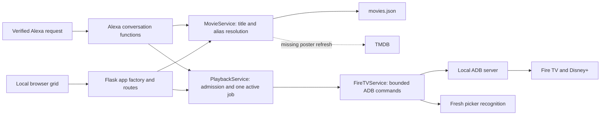
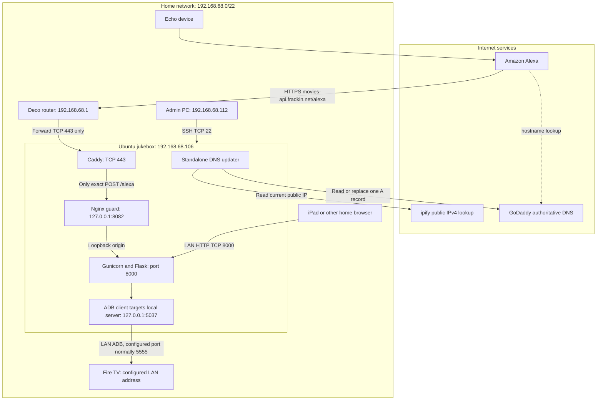

# Movie Magic: current architecture

Documented **November 25, 2026**, from the implementation and the household live
checks recorded in this chat. This page describes the working deployment.
For why each choice was made, see [design decisions](architecture-decisions.md).
For commands and maintenance, see [the operations guide](movie-magic-operations.md).
Earlier baseline and alternative designs are preserved in
[architecture history](architecture-history.md); they are not the deployed topology.

## Purpose and boundaries

Movie Magic lets Zach choose a movie from the local browser grid or through one
voice sentence: "Alexa, ask Movie Magic to play Luca." The existing Ubuntu laptop
coordinates the request; the Fire TV runs Disney+ and plays the movie. Neither
the Echo nor the laptop streams the movie as part of Movie Magic.

The design prioritizes understandable Python, the existing household workflow,
few services and low additional cost. The Alexa release starts movies, resolves
ambiguous titles and can select a recognized no-PIN profile. It does not implement
general media controls or a general-purpose remote-control API for the internet.

## Application architecture

| Component | Responsibility | Boundary |
|---|---|---|
| `app.py`, `config.py` | Construct Flask/services and load private settings | Preserve app factory; no client-provided shell commands |
| `alexa/web.py` | HTTP validation, Amazon verification, owner authorization | No TV side effects before validation |
| `alexa/verification.py` | Bound the SDK certificate fetch/cache | Reuse SDK signature/chain checks rather than invent cryptography |
| `alexa/skill.py` | Plain Python conversation, play/choice/help/cancel | Call the existing services directly; no self-HTTP or ADB |
| `MovieService` | Validate catalog; resolve titles/aliases to permanent keys | Never guess between ambiguous aliases; keep provider mapping backend-owned |
| `PlaybackService` | Admission, cooldown, jobs, request repeat protection | Serialize legacy and newer requests against one command reservation |
| `FireTVService` | Existing wake/Home/deep link and bounded profile helper | Own fixed ADB templates and uncertain-delivery handling |
| `services/disney_profile.py` | Recognize exact focused picker state | Pure XML recognition, no device or network access |
| `tools/update_alexa_dns.py` | Maintain the dedicated public A record | Separate scheduled process; no Flask/TV dependency |

The app runs under Gunicorn with **one worker and four threads**, because command
reservations, quotas, jobs and repeat protection live in that process. One worker
does not mean one HTTP thread. Adding more workers would create separate locks
and require a new shared-state design.

The Alexa handler can respond once the playback job is admitted. Device startup
and optional profile inspection happen in the existing worker; the spoken reply
does not wait for or establish on-screen playback.

The JSON catalog remains authoritative. Application movie keys are immutable;
titles, aliases and provider IDs have different roles. New Alexa/API paths use
keys, while the temporary legacy `/play/<video_id>` contract still accepts valid
provider IDs even when absent from the catalog. Preserve that compatibility until
an explicitly approved retirement. Do not replace the catalog from a code bundle
or migrate its schema silently at startup.

## Network architecture

The Echo sends speech to Amazon. Amazon, rather than the Echo calling the laptop
directly, sends the skill's HTTPS request through the public endpoint. The iPad
path is local and does not traverse that public endpoint.

| Address or port | Role and access |
|---|---|
| `192.168.68.0/22` | Main trusted home subnet, mask `255.255.252.0` |
| `192.168.68.106` | Laptop DHCP reservation in Deco |
| `192.168.68.112` | Admin-PC reservation; allowed SSH source |
| Laptop `wlp1s0` | Interface used in the current UFW rules |
| Public TCP 443 | Deco forwards to laptop 443; Caddy accepts HTTPS |
| Laptop TCP 8000 | Existing grid/application; allowed only from approved home subnet by UFW |
| Loopback TCP 8082 | Nginx Alexa guard; no LAN/WAN listener |
| Loopback client target TCP 5037 | Local ADB server; never publish it |
| Fire TV configured LAN ADB port | Normally 5555; never forward it from the internet |
| Caddy admin port 2019 | Local administration; never forward it |
| TCP 80 | Caddy listens locally; no public router forward needed here |
| UDP 5353 | Existing IPv4/IPv6 discovery rules retained during cleanup |

The diagram describes the observed IPv4 publication path. UFW also has a public
TCP 443 IPv6 allow rule on Wi-Fi, but the work did not establish a separate public
IPv6 route/port scan. Do not infer full IPv6 auditing from working IPv4 Alexa calls.

## DNS and certificates

| Name | Meaning |
|---|---|
| `fradkin.net` and existing website/mail names | Existing GoDaddy Builder website and Google/Gmail email; retained |
| `moviemagic.fradkin.net` | Existing private movie-grid hostname, pointing to the LAN server |
| `movies-api.fradkin.net` | Dedicated public Alexa hostname; dynamic A record for WAN IPv4 |
| `fradkin-movies.tplinkdns.com` | Deco DDNS registration; no longer the CNAME target for the Alexa hostname |

GoDaddy retains registration and authoritative DNS. A systemd timer runs the
standard-library Python updater roughly every five minutes. It reads the public
IPv4 from ipify and the existing GoDaddy A record; a different address causes a
single-record replacement by record ID, preserving TTL. It never replaces the
whole zone. Unchanged addresses produce no write.

Caddy manages the public certificate using ACME/TLS-ALPN validation on TCP 443.
The existing private hostname keeps Caddy's internal certificate and a direct-peer
home-network restriction. These are separate certificate/trust cases. A private
Caddy certificate is not the certificate presented to Amazon for the public name.

The previous CNAME to TP-Link DDNS was removed after CAA lookups for that target
returned `SERVFAIL`. Replacing it with the direct A record allowed public issuance
to succeed. This is the observed failure in this setup, not a claim that all
TP-Link DDNS names always fail certificate checks.

## Trust boundaries and request handling

1. **Router/UFW:** expose only public TCP 443 for Alexa. Keep the grid on the home
   subnet, SSH restricted to the admin PC, and device/admin ports private.
2. **Caddy:** present the public certificate and route only exact original URI
   `/alexa` with POST; deny other public application paths. Restrict the old LAN
   HTTPS site's direct peer so it cannot publish trusted local controls.
3. **Nginx:** exact raw URI/method guard, request size/rate/connection/time bounds,
   no upstream retry, and a minimal forwarded header set. Send the fixed internal
   Host `zmm-origin.internal` without modifying the signed body.
4. **Flask/Alexa:** independently verify size/JSON, freshness, signing certificate,
   original-body signature, skill ID and owner user ID before calling services.
   Context and session identities must agree. LAN access, browser cookies, bearer
   tokens and spoofed forwarding headers cannot substitute for Alexa verification.
5. **Playback/device:** validated catalog resolution and serialized admission,
   fixed command templates, bounded I/O and no replay after uncertain delivery.

Both proxy and backend controls matter. HTTPS protects transport but does not
identify the household owner; skill/account checks provide that restriction.
The public endpoint cannot require Cloudflare Access service-token headers that
Amazon's custom-skill client is not configured to supply.

The direct-peer restriction assumes Caddy can distinguish outside clients from
home/loopback peers. A future proxy or router source-NAT change must preserve or
deliberately redesign that boundary, not make every external caller look local.

The optional Amazon verifier dependencies are pinned separately. The adapter caps
certificate I/O/cache and uses one admitted verification worker, keeping late
verification from launching a movie. A slow/stuck verification can temporarily
make that slot unavailable; this design bounds resources rather than claiming
that every underlying DNS call can be interrupted immediately. Existing upstream
SDK deprecation warnings remain a future maintenance concern, not a failed test.

## State, delivery and failure behavior

Accepted request, delivered ADB command and actual playback are different states.
New job responses and speech describe the evidence available. The successful live
checks additionally included the user's observation of movies playing on the TV.

Jobs and request-ID repeat protection are bounded in-memory state, not a durable
queue. Restarts lose that history and do not replay old work. Check the TV before
repeating an uncertain request. The legacy path retains its established response
wording and behavior rather than silently breaking existing clients.

If the optional profile helper sees the exact recognized picker with `zach`
already focused, it sends one Select event and lets the pending deep link
continue. Other screens, PIN prompts, ambiguity or uncertainty result in no
additional selection. It never relaunches the movie as a profile-recovery step.

An Alexa/DNS/public-HTTPS outage does not remove the local grid path. A laptop,
LAN, ADB or Fire TV failure affects both control paths. Disney+ streaming still
needs Disney+ and internet service regardless of how a request was submitted.

## What is not deployed

Lambda-hosted handlers, Cloudflare Tunnel/Access for Alexa, IFTTT integrations,
Home Assistant, databases/brokers, durable exactly-once delivery, general remote
tablet access, full media transport controls and automatic PIN entry are not
part of the working deployment. Their appearance in older phase plans does not
mean they must be enabled to operate this system.

The [operations guide](movie-magic-operations.md) records exact paths, current
settings, upkeep and recovery. The [decision record](architecture-decisions.md)
explains alternatives and tradeoffs. The [verification record](alexa-verification.md)
distinguishes mocked tests, user-reported live results and remaining untested
events such as WAN-address changes and certificate renewal.
